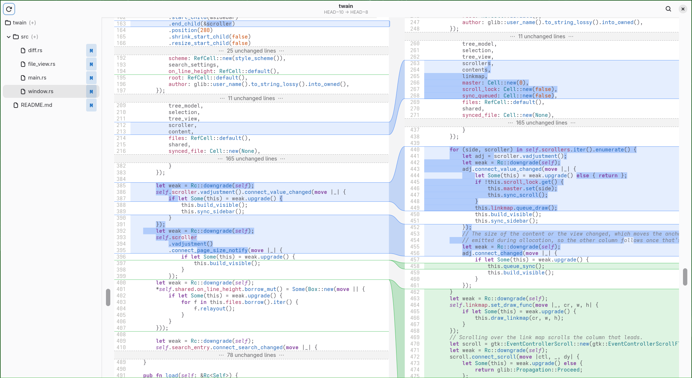

# twain

A diff viewer for people who love Meld, but wanted it to be slightly different.



Things that are like Meld:

  - intuitive and nice view of what changed to what, what was removed from where and added where;
  - scrolling minimaps of changes;
  - git support;
  - fast.

Things we have that Meld doesn't:

  - all files from a Git diff shown in the same view, sequentially;
  - a file tree on the side, super fast;
  - show either the full files or only the parts that changed, with granular revealing of the unchanged parts;
  - tree-sitter-based syntax highlighting;
  - the ability to comment on sets of changes and lines, and AIs can read these comments and add more from a CLI, like Hunk;
  - the ability to search through the entire set of modified files.

Thins Meld has that we don't:

  - merge;
  - three-way comparisons;
  - support for other version control systems;
  - ability to edit the files directly.

## Usage

Run `twain` in your project's directory. It can also compare other Git revisions, but that doesn't matter much for now.

## Comments

Select lines and press `C` or right-click the mouse to leave a comment on them.

Tell your AI agent to look into `twain comment --help` so it can participate.

## Install

Download a binary or a Flatpak bundle from the [latest release](https://github.com/andunieee/twain/releases/latest) or build from source (needs GTK 4, GtkSourceView 5 and libadwaita):

```
cargo install --git https://github.com/andunieee/twain
```
